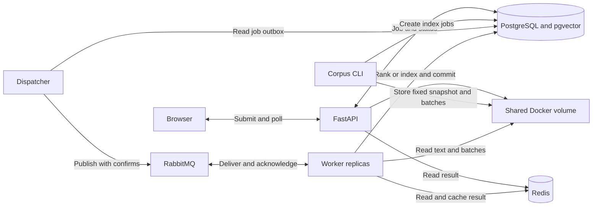

# Research-Paper Similarity Service

**Team**  
Mohadeseh Khoshnevisan and Sepehr Rezaei

Submit a research abstract or a short description and retrieve up to ten related arXiv papers with their authors, links, and cosine similarity scores. The normal worker uses the pretrained CPU model `sentence-transformers/all-MiniLM-L6-v2`. It ranks a fixed corpus of `cs.LG`, `cs.CL`, and `cs.IR` papers using exact pgvector search.

## Run the 25,000-paper service locally

Install Docker with the Compose v2 plugin and start the Docker engine. Run these commands from the repository root. The first build downloads the Python packages. The worker downloads the pinned model into a Docker volume the first time it starts.

```sh
docker compose -p similar-papers config --quiet
docker compose -p similar-papers up -d --build --wait --scale worker=4
docker compose -p similar-papers run --rm tools python -m research_similarity.corpus index data/corpus.jsonl.gz --batch-size 128 --timeout 3600
docker compose -p similar-papers up -d --wait --scale worker=1
```

Open [localhost:8000](http://localhost:8000), choose **Use an example**, then select **Find papers**. Repeat the same query to see the Redis cache response. For a terminal check run `python scripts/smoke.py`. The full snapshot and source checksums are documented in [data/README.md](data/README.md).

The API's database status, corpus count, and model mode are visible at [localhost:8000/healthz](http://localhost:8000/healthz). Expect 25,000 papers and the `minilm` model after indexing. A zero count means the corpus is initializing. For a first run that appears to stall, use `docker compose -p similar-papers ps` and `docker compose -p similar-papers logs --tail 100 worker dispatcher`. `docker compose -p similar-papers down` stops the project and keeps its data volumes.

## Evaluation and deployment

The final submission uses a local deployment with a shared Docker volume. Follow [the local evaluation guide](docs/LOCAL-EVALUATION.md) to reproduce the scaling, caching, and failure tests. Raw measurements are in `docs/evidence/`. [Optional deployment on Google Cloud](docs/DEPLOYMENT.md) describes the originally proposed infrastructure.

For a quick run, use `data/demo.jsonl`, which contains 15 arXiv records with project-written summaries. Use a fresh Compose project name when changing the snapshot or model. If another project is already running, set `APP_PORT` to an available port. The optional `smoke` model hashes words to 384-dimensional vectors for infrastructure checks. Use the default `minilm` model for the full semantic search and benchmark.

## API

| Request | Response |
| --- | --- |
| `GET /healthz` | Database status, indexed paper count, and model mode |
| `POST /jobs` with `{"text":"…"}` | `202` and a job ID on a cache miss, or `200` and completed results on a cache hit |
| `GET /jobs/{job_id}` | `pending`, `processing`, `completed`, or `failed`, with results or an error when applicable |

The input limit is 12,000 normalized characters and the request body limit is 64 KiB. FastAPI's interactive [API reference](http://localhost:8000/docs) includes a sample payload.

## Architecture



The API persists the text and accepts a durable PostgreSQL job. The dispatcher reads unpublished jobs and uses RabbitMQ publisher confirms. If the dispatcher loses its connection before marking a job published, it can publish the same job ID again. The worker serializes attempts with a PostgreSQL advisory lock and acknowledges the RabbitMQ delivery after the terminal database commit. Unacknowledged deliveries return to the queue after connection loss. Redis is optional for correctness and caches results for one hour.

## Verification

```sh
docker compose -p similar-papers build test
docker compose -p similar-papers run --rm test
python scripts/smoke.py
```

The test suite covers request validation, cache and queue responses, and cosine ranking against a NumPy reference when PostgreSQL is available. [The local evaluation guide](docs/LOCAL-EVALUATION.md) contains the failure and benchmark commands. Use public abstracts or your own synthetic examples for the demo. The app binds to loopback and keeps submitted text in the local object volume.

## Sources

- [arXiv bulk metadata](https://info.arxiv.org/help/bulk_data.html) and [the pinned source used for this evaluation](data/README.md)
- [all-MiniLM-L6-v2 model card](https://huggingface.co/sentence-transformers/all-MiniLM-L6-v2)
- [RabbitMQ acknowledgement and confirm semantics](https://www.rabbitmq.com/docs/confirms) and [pgvector cosine search](https://github.com/pgvector/pgvector)
